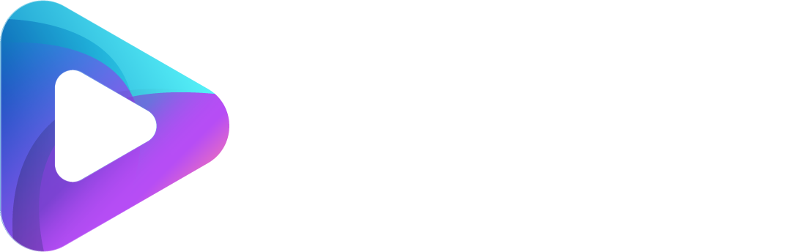
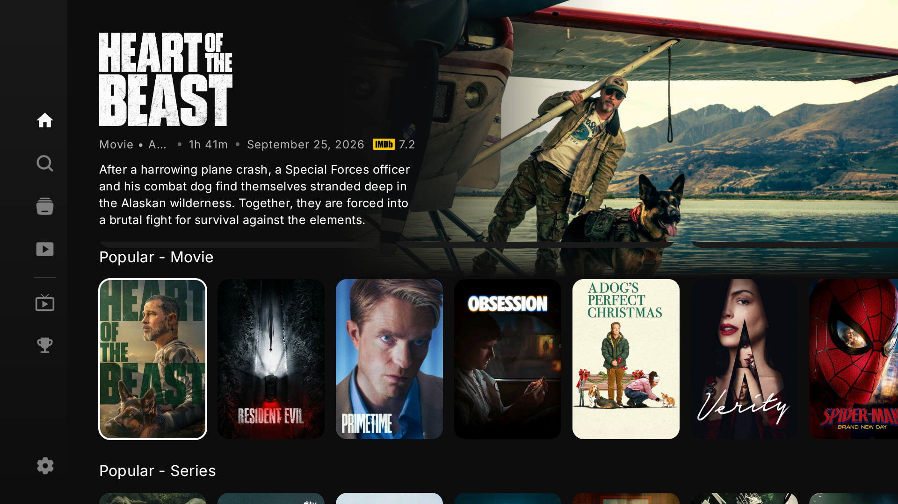
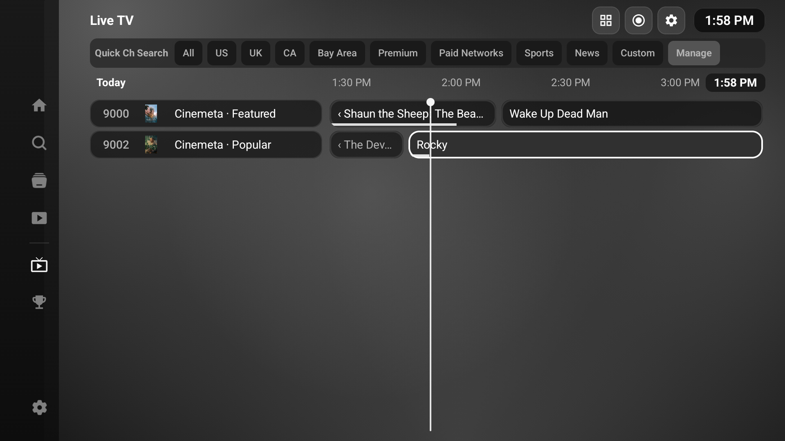
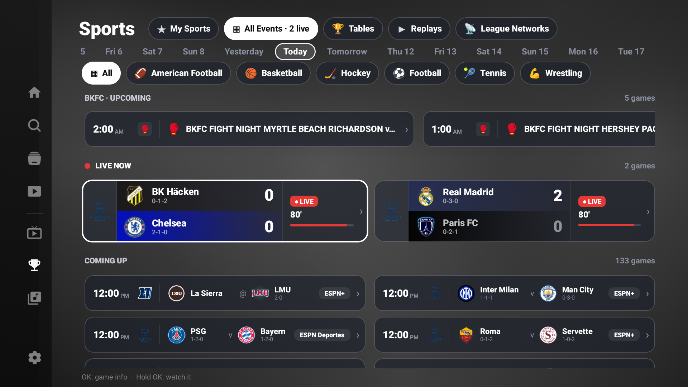
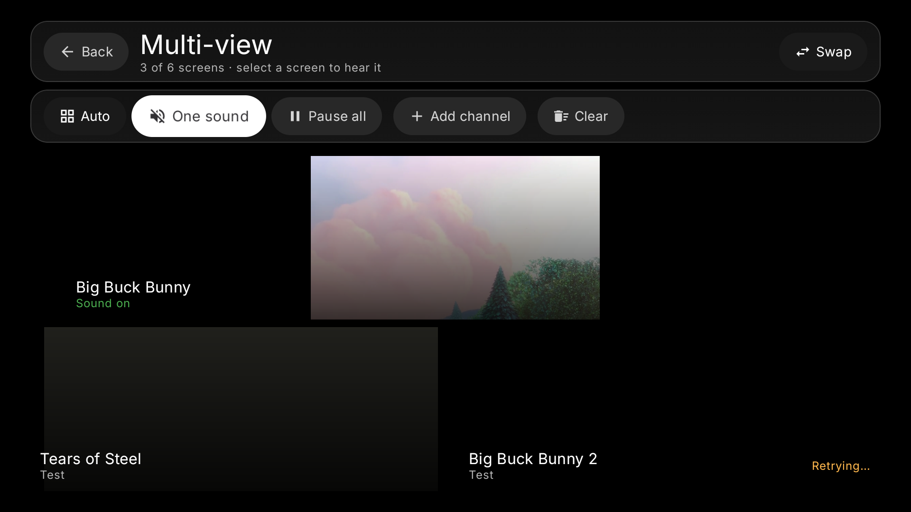
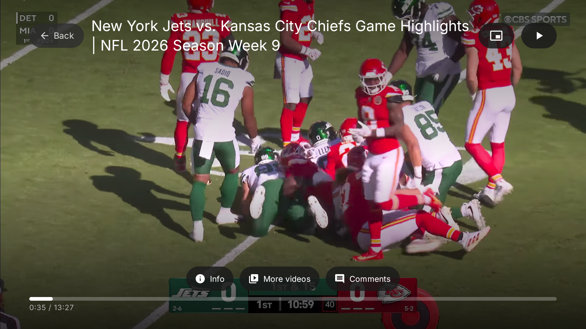
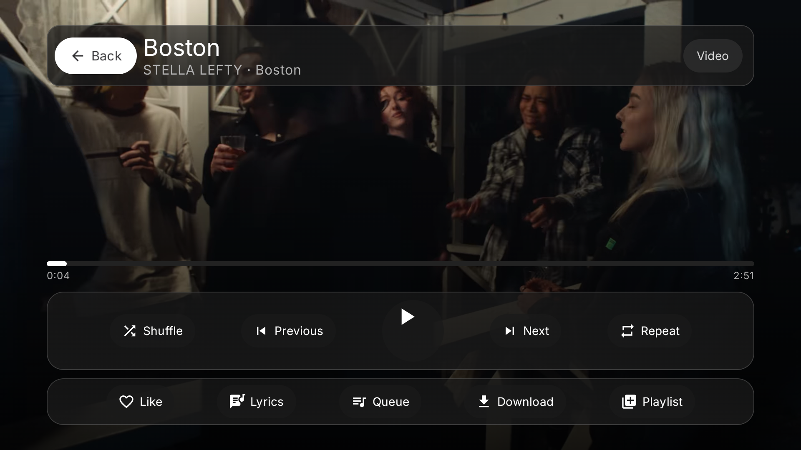
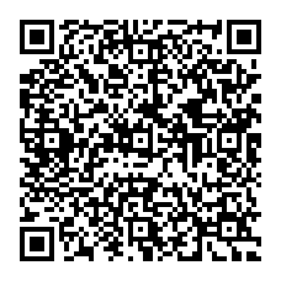

<div align="center">



**Nuvio's library, Live TV, Sports, YouTube and Music in one leanback interface built for a remote.**

[](https://github.com/lucidconviction/Lucid-Nuvio-TV-IPTV/releases/latest)
[](https://github.com/lucidconviction/Lucid-Nuvio-TV-IPTV/releases/latest)
[](LICENSE)

[Install](#-install) · [Features](#-features) · [Remote controls](CONTROLS.md) · [Credits](#-credits)

</div>

---

## 📺 Screenshots

<div align="center">

| Home | Live TV guide |
|:---:|:---:|
|  |  |
| **Sports** | **Multi-view** |
|  |  |
| **YouTube player** | **Music** |
|  |  |

</div>

---

## ✨ Features

### 🏠 Home, library and discovery
- A cinematic hero with backdrop, logo, ratings, runtime, genres and direct play.
- Continue Watching, Top 10, featured and popular rows from your catalogs.
- Stremio catalog add-ons, TMDB discovery and recommendation rows.
- Collections: group catalogs into folders on Home and arrange the row order.
- Search across movies, series, channels, On Demand and your library.
- Library with saved movies and shows, plus cast, crew and filmography pages.
- Trailers, ambient screensaver, and an optional Essential mode for a simpler Home.
- Built-in updater: the app checks for and installs new releases.

### 📡 Live TV and DVR
- Multiple M3U playlists and Xtream logins, merged into one guide.
- XMLTV guides with per-channel EPG assignment and now/next information.
- Full TV guide with channel groups, favourites, recently watched and a fast channel list.
- Catch-up and archive playback where your provider supports it.
- Recordings and scheduled recordings, series recordings, reminders and a channel calendar.
- Quick Channels for switching without leaving the player.
- Drag-to-reorder groups and channels, hide channels or groups, copy channels, rename, renumber and set custom logos.
- Backup streams, channel numbers, stream info, sleep timer and playback diagnostics.
- Parental controls with locked groups and adult-content filtering.
- **Multi-view:** watch up to four channels at once, with automatic layouts, per-window volume, swapping, pause, refresh and ten saved layouts.
- Add-on catalogs appear as normal guide channels with full screen, channel surfing and a stream menu.

### 🎬 Lucid TV
- Virtual channels built from add-on catalogs, series marathons, playlist relays and hand-picked collections.
- A dedicated Lucid TV studio for creating and editing channels.
- Series catalogs expand into real episodes with season/episode numbers and runtimes.
- Generated guide with join-in-progress playback.
- Smart pools: genre, year, rating, keyword filters, shuffle, release order and air order.
- HTTP-first tuning, optional debrid, cached winners and next-two prefetch for fast channel changes.
- Plays movies, series and existing Live TV channels as 24/7 channels.

### 🎞️ On Demand
- Movies and series from Xtream providers, with categories, search, sorting and quality tags.
- Merge duplicate titles across providers.
- Parental locks for categories and titles.
- Long-press poster actions for details, library, watched state and playback.

### 🏆 Sports
- Live scores, schedules, results and league tables.
- My Sports, All Events, league filters, team and league following.
- BKFC event calendar alongside the major leagues.
- Game pages with every channel showing the event, score, team cards and table position.
- Reminders, recordings, pre-event and post-event videos.
- Sports Replays powered by the built-in YouTube player.
- Pinned live scores and at-a-glance game cards.

### ▶️ YouTube
- Home, Subscriptions, History, Playlists, Channels, Live, Music, Gaming, News, Sports and Shorts.
- Search, channel pages and playlist browsing.
- Sign in with Google's TV code or QR — no password typed on the TV.
- Info, More videos and Comments panels, with two-level comment replies.
- Autoplay the next video from the list you started watching.
- Remote seeking: press Down to focus the progress bar, then Left/Right to jump 10 seconds.
- Continue Watching on Home with thumbnails and progress.

### 🎵 Music
- Deezer-powered discovery: trending tracks, artists, albums, playlists and genres.
- Official music videos resolved through YouTube and played in the built-in player.
- Synced lyrics.
- A personal music library, playlists and downloads for offline listening.
- Music player with artwork, queue and remote-friendly controls.

### 👥 Watch party
- Create or join a party with a short code and invite link.
- Up to three seats with host controls.
- Synced playback with each member's drift shown.
- Works with the regular player.

### 🧰 Add-ons, plugins, servers and debrid
- Stremio add-ons: catalogs, metadata and streams.
- Plugin repositories and external stream providers.
- Jellyfin and Emby media servers for browsing and playing your own library.
- Debrid: Real-Debrid, Premiumize and TorBox, with cached checks, file selection and direct playback.
- Catalog ordering, collections and add-on management.
- Manage add-ons from your phone with a QR code.

### 👤 Profiles, sync and tracking
- Multiple profiles with their own library, progress, add-ons and settings.
- Nuvio account sign-in with a QR code completed on your phone.
- Sync library, watch progress, add-ons and plugins across devices.
- Trakt, Simkl and MDBList: scrobbling, watch progress, libraries and lists.
- Choose which service supplies your library, progress and recommendations.

### 🛡️ VPN
- Import OpenVPN or WireGuard profiles.
- Connect the whole app or only HTTP/HTTPS traffic.
- Connection verification, live traffic counters and VPN IP display.
- Profiles are stored locally on the device.

### 🎛️ Look, feel and playback
- Themes, accent colours, poster depth, glass panels and multiple Home layouts.
- Choose what appears in the side menu, its order, and the page the app opens on.
- Experience modes: Full or Essential.
- Media3/ExoPlayer with FFmpeg audio, HDR/Dolby Vision MKV support where the device allows it.
- Subtitles, audio tracks, playback speed, aspect ratio adjustment and stream info.
- Picture-in-picture, external player support, sleep timer, backup streams and reload.
- The screen stays awake while the app is open.

---

## 📦 Install

### Android TV / Google TV — Downloader app

1. Install **Downloader by AFTVnews** on your TV.
2. Enter the Downloader code:

   ```text
   9027970
   ```

   The code downloads the universal APK, which works on any device. The release page also has smaller arm64 and 32-bit APKs.

Scan the QR code with your phone to open the release page:



### Sideload with ADB

```bash
adb install -r LucidNuvioTV-arm64-v8a.apk
```

Or download the latest APK directly:

```bash
curl -L -o LucidNuvioTV.apk \
  https://github.com/lucidconviction/Lucid-Nuvio-TV-IPTV/releases/latest/download/LucidNuvioTV-universal.apk
```

---

## ✅ Requirements

- Android TV or Google TV, Android 7.0 (API 24) or newer.
- A remote with a D-pad.
- A Live TV playlist (M3U or Xtream) for Live TV and Sports channels.
- Optional: a YouTube account for subscriptions, history and playlists.
- Optional: a debrid account, Jellyfin/Emby server or VPN profile.

A full remote-control map is in [CONTROLS.md](CONTROLS.md).

---

## 📝 Notes

- This app does not include any playlists, accounts or paid subscriptions.
- The ambient/screensaver slideshow is off by default; enable it in Settings if you want it.
- Picture-in-picture availability depends on the device and system version.
- Recordings are stored locally on the device.
- Live TV, On Demand, Sports data and EPG belong to their respective providers.
- The app is built for the big screen: 1080p and 4K TVs are supported.

---

## 🙏 Credits

- [Nuvio](https://github.com/lucidconviction/NuvioTV_Rdnutz) — the original Nuvio TV experience.
- **Nuvio One / Nuvio + IPTV** — the Live TV and IPTV foundation.
- The open-source projects whose playback and TV interface libraries make this app possible.
- All playlist, guide and sports data belongs to its respective providers.

This fork is unofficial and is **not affiliated with or endorsed by NuvioMedia**. Please report issues with this fork here, not to the upstream teams.

---

## ⚖️ License

This project is shared for personal use. Third-party components keep their own licenses. See [LICENSE](LICENSE).
