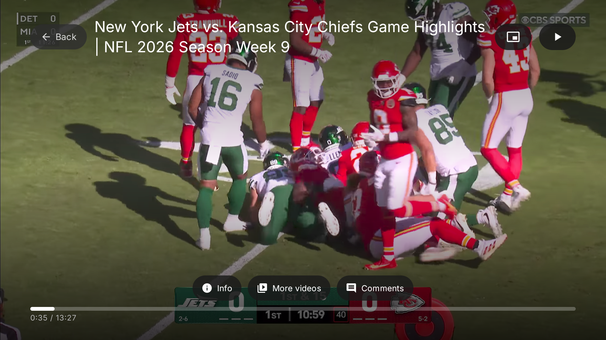
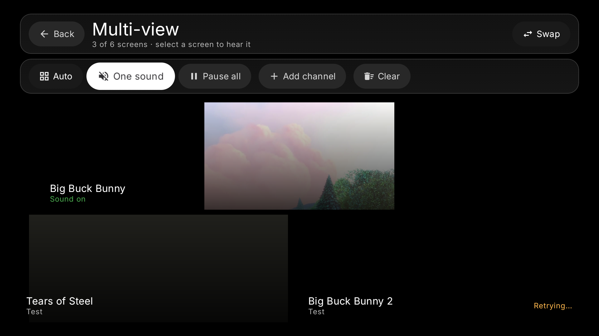
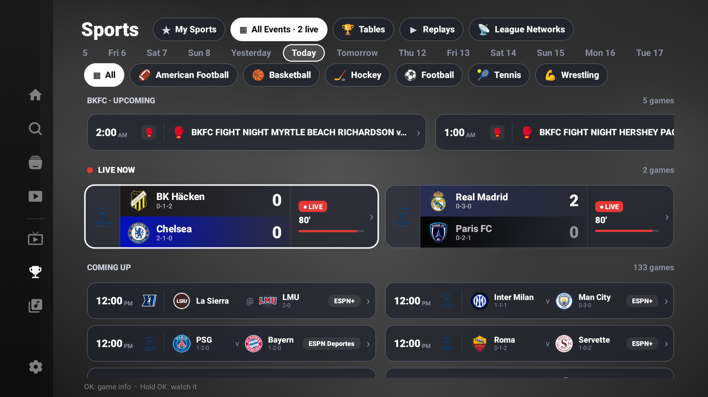
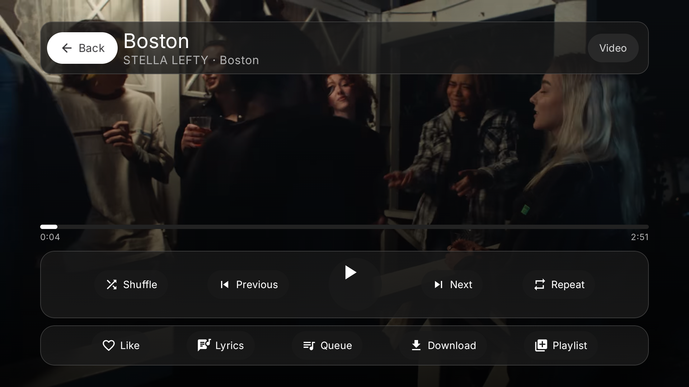

# Lucid Nuvio TV IPTV

A TV-first streaming app for Android TV and Google TV. Nuvio's library, Live TV, Sports, YouTube and Music in one leanback interface built for a remote — no mouse, no touch, no keyboard required.



## Features

### Live TV
- Full EPG guide with channel groups, favourites, recently watched and a fast channel list.
- Catch-up and archive playback where your provider supports it.
- Recordings, scheduled recordings, reminders and a TV guide that stays out of the way.
- Quick Channels: curated channel names such as ESPN, CNN, Sky Sports and regional bundles, matched across every playlist.
- Channel backup streams, channel numbers, custom logos, hidden channels and arrangeable groups.
- Multi-view for watching up to **six channels at once**.

### Multi-view
- Auto layout that grows with each added channel: one full screen, two shared, then one large + smaller windows, grids and more.
- Named layouts per window count, plus quick window swapping.
- Per-window volume, fullscreen, swap and pause from a long-press window menu.
- Controls hide after five seconds and return on any remote press, so the windows use the whole screen.
- One sound or all sound, pause all, and screen-awake while multi-view is open.



### Sports
- Live scores, schedules, results and league tables.
- My Sports, All Events, league filters and team following.
- BKFC event calendar alongside the major leagues.
- Sports Replays powered by the built-in YouTube player.
- Pinned live scores and at-a-glance game cards.



### YouTube
- A full YouTube tab with Home, Subscriptions, History, Playlists, Channels, Live, Music, Gaming, News, Sports and Shorts.
- Search, channel pages and playlist browsing.
- Sign in with Google's TV code or QR — no password typed on the TV.
- Player with Info, More videos and Comments panels.
- Comments are two levels: the main comment list, then replies for any comment.
- Autoplay next video from the list you started watching.
- Remote seeking: press Down to focus the progress bar, then Left/Right to jump 10 seconds.
- Picture-in-picture where the device supports it.
- Continue watching on Home with thumbnails and progress.

### Music
- Songs, artists, albums, playlists, genres and downloads.
- Video and audio-only modes.
- Synced lyrics, queue management and a full-screen player.
- Automatic next track and crossfade between tracks.
- Remote-first controls that hide after five seconds and return with Play focused.



### Player
- Subtitles, audio tracks, playback speed, aspect ratio and stream info.
- Picture-in-picture for video playback.
- Sleep timer, backup streams, quick channels and stream reload.
- External player support and playback diagnostics.
- Smooth transitions and glass-style panels throughout the app.
- The screen stays awake while the app is open.

## Install

### Android TV / Google TV — Downloader app

1. Install **Downloader by AFTVnews** on your TV.
2. Enter the Downloader code:

   ```text
   9027970
   ```

   The code downloads the universal APK, which works on any device. The release page also has smaller arm64 and 32-bit APKs.

Scan the QR code with your phone to open the release page:


### Sideload with ADB

```bash
adb install -r LucidNuvioTV-arm64-v8a.apk
```

Or download the latest APK directly:

```bash
curl -L -o LucidNuvioTV.apk \
  https://github.com/lucidconviction/Lucid-Nuvio-TV-IPTV/releases/latest/download/LucidNuvioTV-universal.apk
```

## Requirements

- Android TV or Google TV, Android 7.0 (API 24) or newer.
- A remote with a D-pad.
- A Live TV playlist (M3U or Xtream) for Live TV and Sports channels.
- Optional: a YouTube account for subscriptions, history and playlists.

## Notes

- This app does not include any playlists, accounts or paid subscriptions.
- Picture-in-picture availability depends on the device and system version.
- Recordings are stored locally on the device.
- The app is built for the big screen: 1080p and 4K TVs are supported.

## Credits

- [Nuvio](https://github.com/lucidconviction/NuvioTV_Rdnutz) — the original Nuvio TV experience.
- **Nuvio One / Nuvio + IPTV** — the Live TV and IPTV foundation.
- The open-source projects whose playback and TV interface libraries make this app possible.
- All playlist, guide and sports data belongs to its respective providers.

## License

This project is shared for personal use. Third-party components keep their own licenses.
